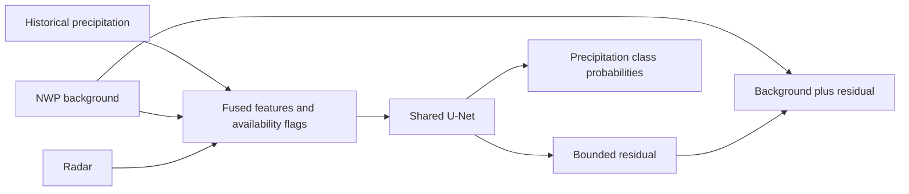

# Raincast: NWP-Anchored Multitask Precipitation Modelling

[简体中文](README.md) | **English**

A PyTorch project for learning precipitation correction methods. It combines historical precipitation, numerical weather prediction (NWP), and radar inputs in a shared U-Net to predict precipitation amounts and five-class probabilities for three forecast periods.

The repository includes general-purpose models, a cached-data interface, synthetic data generation, and training and inference examples. All demonstration samples are randomly generated; predictive performance on real weather data has not been validated.

## Method



- Correct the NWP background in log1p space: `pred_log = tp_log + 0.35 * tanh(residual)`.
- Jointly learn continuous precipitation amounts and discrete intensity classes.
- Use masked SmoothL1, weighted focal cross-entropy, and Soft-TS losses.
- Combine random modality dropout with availability channels to demonstrate training with missing inputs.

These settings illustrate the method. They are not validated optimal parameters or claims of methodological novelty.

## Quick start

Python 3.10+ is required. The small demonstration can run on a CPU. Run these commands from the repository root:

```bash
python -m venv .venv
# Windows: .venv\Scripts\activate
# macOS / Linux: source .venv/bin/activate
python -m pip install -r requirements.txt
python scripts/make_synthetic_cache.py --output-dir examples/cache
python scripts/train_tp_radar_multitask.py --surface-cache examples/cache/surface --tp-cache examples/cache/tp --radar-cache examples/cache/radar --output-dir outputs/demo --epochs 1 --batch-size 2 --num-workers 0 --patch-size 32
python scripts/predict_synthetic.py --checkpoint outputs/demo/best.pt
python -m unittest discover -s tests -v
```

The demonstration generates four training samples and two validation samples, then exercises cache loading, training, checkpoint saving, and inference. The output, `outputs/prediction.npz`, contains `rain_mm` and `class_probability`. Random samples do not represent real meteorological relationships, so the demonstration loss does not measure forecasting skill.

## Code guide

| File | Purpose |
|---|---|
| `scripts/train_tp_residual_unet.py` | Cache loading, bounded-residual model, and regression training |
| `scripts/train_tp_radar_multitask.py` | Multitask model, modality dropout, and joint loss |
| `scripts/make_synthetic_cache.py` | Random demonstration data generation |
| `scripts/predict_synthetic.py` | Loading a local demonstration checkpoint and running inference |
| `tests/test_model_contract.py` | Residual bounds, modality handling, and gradient checks |

## Using real data and limitations

Prepare data you are authorized to use according to the [cached-data interface](docs/DATA_FORMAT.en.md). Split training and validation sets by weather event, keeping each event entirely within one split. Spatial coordinates, observation times, and NWP initialization times require separate checks.

The project has not been validated for operational deployment. A lower training loss does not necessarily mean better forecasts; evaluate on independent samples with appropriate baselines and results broken down by precipitation intensity.

Further reading: [Method](docs/METHOD.en.md) · [Data format](docs/DATA_FORMAT.en.md) · [Validation](docs/VALIDATION.en.md) · [Use and distribution](docs/PUBLICATION.en.md).
