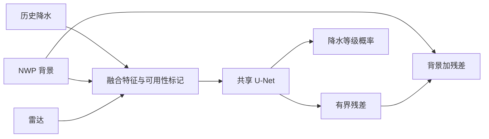

# Raincast：NWP 锚定的多任务降水预测示例

**简体中文** | [English](README.en.md)

一个用于学习降水订正方法的 PyTorch 项目：融合历史降水、数值天气预报（NWP）和雷达，通过共享 U-Net 输出三个预测时段的降水量及五分类概率。

仓库提供通用模型、缓存数据接口、合成数据、训练和推理示例。全部演示样本由随机数生成；目前没有真实天气数据上的效果验证。

## 方法



- 在 log1p 空间订正 NWP：`pred_log = tp_log + 0.35 * tanh(residual)`。
- 联合学习连续雨量和离散强度等级。
- 使用带掩膜的 SmoothL1、加权 focal CE 和 Soft-TS 损失。
- 随机模态丢弃配合可用性通道，演示对缺失输入的训练处理。

上述配置用于展示方法，不代表已验证的最佳参数或原创性结论。

## 快速开始

Python 3.10+，小型示例可在 CPU 运行。在仓库根目录执行：

```bash
python -m venv .venv
# Windows: .venv\Scripts\activate
# macOS / Linux: source .venv/bin/activate
python -m pip install -r requirements.txt
python scripts/make_synthetic_cache.py --output-dir examples/cache
python scripts/train_tp_radar_multitask.py --surface-cache examples/cache/surface --tp-cache examples/cache/tp --radar-cache examples/cache/radar --output-dir outputs/demo --epochs 1 --batch-size 2 --num-workers 0 --patch-size 32
python scripts/predict_synthetic.py --checkpoint outputs/demo/best.pt
python -m unittest discover -s tests -v
```

演示生成 4 个训练样本和 2 个验证样本，完成缓存读取、训练、检查点保存和推理。输出 `outputs/prediction.npz` 含 `rain_mm` 和 `class_probability`。随机样本之间没有真实气象关系，演示损失不用于衡量预报能力。

## 文件导航

| 文件 | 用途 |
|---|---|
| `scripts/train_tp_residual_unet.py` | 缓存读取、有界残差模型、回归训练 |
| `scripts/train_tp_radar_multitask.py` | 多任务模型、模态丢弃、联合损失 |
| `scripts/make_synthetic_cache.py` | 生成随机演示数据 |
| `scripts/predict_synthetic.py` | 加载本地示例检查点并推理 |
| `tests/test_model_contract.py` | 残差约束、模态处理及梯度检查 |

## 真实数据接入与局限

自行将有权使用的数据整理为 [缓存接口](docs/DATA_FORMAT.md)。按天气过程划分训练与验证集，避免同一过程跨集合。需要另行验证空间坐标、观测时间和 NWP 起报时间。

本项目没有经过业务部署验证。更低的训练损失不代表更好的实际预报；应使用独立样本、合理基线及逐强度评估。

更多说明：[方法](docs/METHOD.md) · [数据接口](docs/DATA_FORMAT.md) · [验证记录](docs/VALIDATION.md) · [使用与发布](docs/PUBLICATION.md)。
